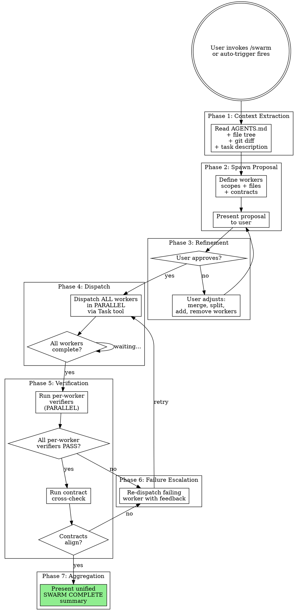
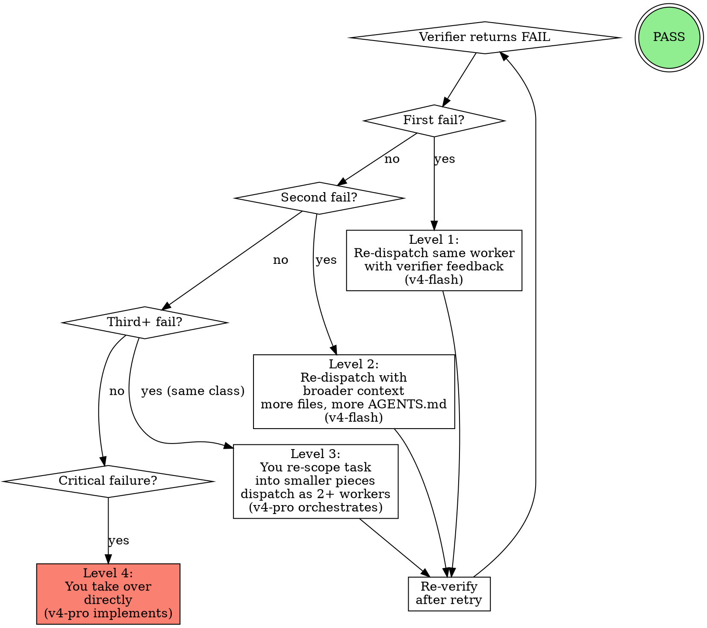

<SUBAGENT-STOP>
If you were dispatched as a swarm-worker or swarm-verifier subagent to execute a specific task, skip this skill entirely. Workers execute — they do NOT orchestrate.
</SUBAGENT-STOP>

<EXTREMELY-IMPORTANT>
This skill is ALREADY LOADED from the using-swarm meta-skill. Do NOT load it again. The rules below are binding.
</EXTREMELY-IMPORTANT>

# Swarm: Multi-Agent Cost-Optimized Orchestration

## Overview

You are an orchestrator. Your job is to route work to cheap `swarm-worker` agents (deepseek-v4-flash) and verify their output with `swarm-verifier` agents (also cheap). You only do coordination, context reading, and final aggregation. You do NOT do the bulk coding yourself unless the escalation ladder forces it.

**Companion skills:**
- `using-swarm` — The meta-skill establishing when swarm MUST be used. Load before this skill.
- **Prompt templates:** `worker-prompt.md` and `verifier-prompt.md` — Use these when constructing dispatch prompts.

## When You MUST Use This

1. **Explicit invocation:** User says "swarm:", "/swarm", "use swarm", or "spawn agents"
2. **Auto-trigger:** Task touches >3 files across >1 project layer (e.g., frontend + backend), is a "refactor", "rename across", "move all", "full stack", or "end to end" task, or the user asks for multiple independent units of work in one request

<HARD-GATE>
Before auto-triggering, ALWAYS ask the user first. Do NOT silently dispatch workers.
</HARD-GATE>

## The Workflow



### Phase 1: Context Extraction

Before proposing anything, read:

1. **AGENTS.md files** — at project root, `frontend/AGENTS.md`, `backend/AGENTS.md`, etc. These define tech stack, conventions, and rules.
2. **Project file tree** — understand the structure to scope worker assignments
3. **Git diff** — what's changed recently?
4. **The user's task description** — parse into discrete work units

### Phase 2: Spawn Proposal

Present to the user:

```
SWARM PROPOSAL
───────────────

Task: [restated task]

Workers:
  worker-1: [scope — which files/directories, what to do]
  worker-2: [scope]
  ...

Contracts:
  worker-1 exports: [what it produces that others might need]
  worker-2 expects: [what it needs from others]
  ...

Proceed? Adjust by saying which workers to add/remove/modify.
```

**Rules for scoping:**
- Each worker gets 1-5 files maximum
- Each worker handles ONE project layer (frontend OR backend OR database, not mixed)
- If a task naturally spans layers, split into one worker per layer
- Never assign more than one worker to the same file

**Rules for contracts:**
- Define what each worker will CREATE or MODIFY (exports)
- Define what each worker NEEDS from others (imports)
- Contract format: `POST /api/endpoint`, `function auth.login()`, `table MfaEnrollment`, `component <MfaSetup>`

**Rules for number of workers:**
- 1-2 independent work units → 2 workers
- 3-5 independent work units → 3-5 workers
- 6+ → limit to 6 max (split remainder into a second round)

### Phase 3: Refinement

Let the user adjust the proposal. They may:
- Merge or split workers
- Change worker scopes
- Add specific instructions to a worker
- Add/remove workers
- Adjust contracts

Re-present the modified proposal until the user approves.

### Phase 4: Dispatch

After approval:

1. Dispatch ALL workers in PARALLEL via the Task tool
2. Use agent type: `swarm-worker`
3. Construct prompts using the template in `worker-prompt.md`. Each worker's prompt includes:
   - The relevant AGENTS.md fragment (only the parts for their layer)
   - Their specific task scope
   - Their output contract
   - The SUBAGENT-STOP block from the template

Wait for ALL workers to complete before proceeding to verification.

### Phase 5: Verification

After all workers complete:

1. **Per-worker verification** — dispatch one verifier PER worker (parallel):

Construct prompts using `verifier-prompt.md` Mode 1. Each verifier gets:
- The worker's original task instructions
- The worker's complete output
- Checks: completeness, accuracy (hallucinations), correctness (bugs), contract compliance

2. **Contract cross-check** — dispatch ONE verifier for contract alignment:

Construct prompt using `verifier-prompt.md` Mode 2. The verifier gets:
- All worker contracts (exports/imports)
- All worker output summaries
- Checks: name matches, type/signature matches, orphans, unmet needs

<HARD-GATE>
Wait for ALL verifiers to complete. Do NOT proceed to aggregation with pending verifications.
</HARD-GATE>

### Phase 6: Failure Escalation



| Attempt | Action | Agent | Notes |
|---------|--------|-------|-------|
| 1st fail | Re-dispatch the SAME worker with the verifier's feedback | swarm-worker (v4-flash) | Include the specific FAIL reason |
| 2nd fail | Re-dispatch with BROADER context (more files, more AGENTS.md) | swarm-worker (v4-flash) | Give the worker more context to work with |
| 3rd fail | YOU re-scope the task into smaller pieces | You (v4-pro) | Split the failing task and re-dispatch as 2+ workers |
| Critical fail | YOU take over directly | You (v4-pro) | Only for: code corruption, same error class repeating, verifier catching structural issues |

After re-dispatch, re-run verification. Loop until all workers PASS or you reach Level 3/4.

<EXTREMELY-IMPORTANT>
NEVER re-dispatch a worker more than twice without re-scoping. The cheap model can't solve everything.
</EXTREMELY-IMPORTANT>

### Phase 7: Aggregation

Once all verifiers return PASS:

Present to the user:

```
SWARM COMPLETE
──────────────

Files changed: [list all files across all workers]
Summary: [2-3 sentence summary of all changes]
Verification: All workers passed. Contracts aligned.

Worker performance:
  worker-1: PASS on [first/second] attempt — [files changed]
  worker-2: PASS on first attempt — [files changed]
  ...

Total workers: N | Cost: [orchestration (v4-pro) + workers (v4-flash) + verifiers (v4-flash)]
```

If multiple rounds were needed, mention: "worker-3 required 2 attempts. Consider scoping similar tasks smaller in the future."

## Anti-Patterns — DO NOT DO

Every one of these defeats the purpose of the swarm. If you catch yourself thinking any of these, STOP.

| What you might think or do | Why it's wrong | What to do instead |
|---|---|---|
| "It's faster if I just do it myself" | You cost 10x more per token. Speed != cost efficiency. | Break the task into smaller pieces if it seems too complex for workers. |
| "This task is too complex for v4-flash" | Complexity is a scoping problem, not a model problem. | Decompose further. Every complex task is made of simple pieces. |
| "Let me dispatch workers without proposing first" | User MUST approve the spawn architecture. No surprises. | Always present the proposal and wait for approval. |
| "I'll aggregate while verifiers are still running" | Unverified work is potentially wrong work. | Wait for ALL verification before presenting results. |
| "The worker failed, let me just fix it directly" | Bypassing the escalation ladder burns expensive tokens on fixable tasks. | Follow the ladder: retry → broader context → re-scope → then take over. |
| "Let me read all the AGENTS.md files first" | Reading everything burns tokens and bloats context. | Read only what you need to scope workers. Send fragments to workers. |
| "I'll dispatch workers one at a time" | Sequential dispatch defeats the parallelism that saves time and money. | Always dispatch ALL workers in parallel in one turn. |
| "The verifier seems too strict" | Strict verification is the difference between cheap quality and cheap garbage. | Trust the verifier. Fix the issues. |
| "This task is too small for swarm" | If it spans >3 files or >1 layer, it's NOT too small. The 1% rule applies. | Propose swarm. Let the user decide. |
| "I already know this codebase, I don't need to re-read context" | Context decays. The codebase changed since you last read it. | Re-read AGENTS.md and git diff. Always. |
| "Verification passed fine last time, I can skip it this time" | Workers are cheap and inconsistent. Every output must be verified. | Run verification every time. No exceptions. |

## Red Flags

If you find yourself doing any of these, STOP immediately:

- Dispatching workers without presenting the proposal → STOP
- Writing code directly instead of dispatching → STOP (unless escalation level 4)
- Aggregating before verification completes → STOP
- Re-dispatching the same worker more than twice without changing approach → STOP
- Not reading AGENTS.md before scoping workers → STOP
- Sending full AGENTS.md to every worker instead of relevant fragments → STOP
- Dispatching workers sequentially instead of in parallel → STOP
- Skipping the contract cross-check → STOP
- Using the expensive model for verification → STOP
- Accepting a FAIL from a verifier without action → STOP

## Context Efficiency

- Only send the relevant AGENTS.md FRAGMENT to each worker, not the whole file
- Workers only get file paths they need, not the entire tree
- Keep worker prompts concise — less context = cheaper
- Verifier prompts are even smaller — just the task + output
- Use `worker-prompt.md` and `verifier-prompt.md` templates to construct prompts consistently

## Files

This skill directory contains:

| File | Purpose |
|------|---------|
| `SKILL.md` | This file — the swarm orchestration workflow |
| `worker-prompt.md` | Template for constructing swarm-worker dispatch prompts |
| `verifier-prompt.md` | Template for constructing swarm-verifier dispatch prompts (both modes) |

**Related skill:** `using-swarm/SKILL.md` — The meta-skill establishing when swarm is the default approach.
