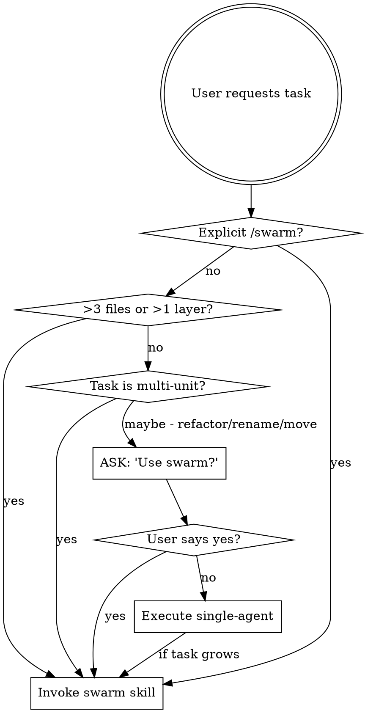

# Using Swarm

## The Rule

**Complex tasks MUST use swarm orchestration.** This is not optional. This is not a suggestion. You route work to cheap workers (v4-flash) and verify their output. The expensive model (v4-pro) only orchestrates.



<EXTREMELY-IMPORTANT>
If you think there is even a 1% chance a task could benefit from swarm, you ABSOLUTELY MUST propose it to the user.

This is not negotiable. This is not optional. You cannot rationalize your way out of this.
</EXTREMELY-IMPORTANT>

## Instruction Priority

1. **User's explicit instructions** (AGENTS.md, GEMINI.md, direct requests) — highest priority
2. **Swarm skill** — governs how work is dispatched
3. **Other skills** (brainstorming, TDD, debugging) — integrate with swarm as needed
4. **Default system prompt** — lowest priority

If the user says "just do it yourself, don't use swarm," follow their instructions. The user is in control.

## The Cost Model

```
Without Swarm:               With Swarm:
┌──────────────┐             ┌──────────────┐
│   v4-pro     │ 100%        │   v4-pro     │ ~10% (orchestration)
│  (expensive) │ of tokens   │  (expensive) │
└──────────────┘             └──────────────┘
                                      │
                             ┌────────┼────────┐
                             │        │        │
                        ┌────▼───┐ ┌──▼────┐ ┌─▼────────┐
                        │ worker │ │worker │ │ verifier │ ~90%
                        │ v4-flash│ │v4-flash│ │ v4-flash │ of tokens
                        └────────┘ └───────┘ └──────────┘
```

Every task you do yourself on the expensive model is a cost failure. Your job is to NOT write code. Your job is to break work into pieces and dispatch.

## Red Flags

These thoughts mean STOP — you're rationalizing:

| Thought | Reality |
|---------|---------|
| "This is just a quick fix" | Quick fixes touch multiple files. Check. |
| "I can do it faster myself" | Faster != cheaper. You cost 10x more per token. |
| "This task needs context awareness" | Give workers the AGENTS.md fragment. Solved. |
| "The codebase is too interconnected" | Define contracts. Split by contracts, not files. |
| "One worker will break another's code" | That's what verifiers are for. |
| "Let me just prototype it first" | Prototyping burns expensive tokens. Dispatch instead. |
| "The user didn't say /swarm" | The 1% rule applies regardless. |
| "I remember how swarm works" | Skills evolve. Read the current version every time. |
| "Verification is overkill for this" | Verifiers are cheap. Bugs in production are expensive. |
| "I already read the AGENTS.md" | Re-read it. Context decays. |

## Integration with Other Skills

**swarm + brainstorming:** Before dispatching a large swarm task, use brainstorming to design the approach. The brainstorming output informs the spawn proposal.

**swarm + TDD:** Workers should follow TDD within their scoped tasks. Include "Follow TDD: write tests first" in worker prompts when appropriate.

**swarm + debugging:** For debugging, use the systematic-debugging skill first to identify the root cause. Then dispatch workers to fix the root cause and all its effects in parallel.

**swarm + writing-plans:** The swarm skill can implement a plan produced by writing-plans. The plan's task decomposition maps naturally to worker assignments.

## Anti-Patterns

| What you might do | What you must do instead |
|-------------------|--------------------------|
| Write all the code yourself | Break into pieces, dispatch workers |
| Skip the spawn proposal | Always propose before dispatching |
| Dispatch one worker at a time | Dispatch ALL workers in parallel |
| Skip verification | Run per-worker + contract verifiers |
| Give up on a failed worker | Follow the escalation ladder |
| Send full AGENTS.md to every worker | Send only the relevant fragment |
| Present results before verifiers finish | Wait for ALL verifications |
| Use v4-pro for workers | NEVER. Workers are always v4-flash |
